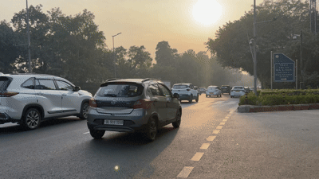

# Classical Vehicle Motion Tracker 

A classical computer vision pipeline developed using Python, OpenCV, and NumPy to detect vehicles and track their motion vectors across video frames without relying on deep learning inference.

## Demonstration



## Implementation Details

The pipeline uses classical feature tracking to capture vehicle displacement across consecutive frames:

1. **Resolution Normalization:**
   - Standardizes video streams to a 960px width while preserving the original aspect ratio.
   - Prevents window scaling issues across varied resolutions (such as 720p, 1080p, or 4K).

2. **Region of Interest (ROI) Masking:**
   - Restricts keypoint extraction to the roadway area (between 48% and 88% of frame height, and 10% to 90% of frame width).
   - Eliminates false detections from the sky, mountain ridges, tree canopies, and the ego-vehicle's hood.

3. **Shi-Tomasi Feature Detection:**
   - Detects sharp corner keypoints using `cv2.goodFeaturesToTrack` with a quality threshold of 0.15.
   - Sets a minimum distance of 25 pixels between points to avoid clustering on a single spot.

4. **Pyramidal Lucas-Kanade Optical Flow:**
   - Computes displacement vectors between consecutive frames using `cv2.calcOpticalFlowPyrLK`.
   - Uses a 4-level image pyramid and a 25x25 pixel neighborhood window to track both fast-moving and distant vehicles.

5. **Displacement Filtering & Motion Trails:**
   - Filters out stationary background noise and erratic jumps by keeping only points that move between 1.0 and 35.0 pixels per frame.
   - Implements a fading overlay layer (dimming by 10% each frame) to create smooth motion trails behind moving cars.
   - Automatically refreshes tracked points every 30 frames to lock onto new incoming vehicles.

## Project Structure

```text
├── tracker.py          # Main optical flow tracking pipeline
├── input_video.mp4     # Input road traffic video
├── tracker_demo.gif    # Animated demonstration for documentation
└── README.md           # Documentation and methodology